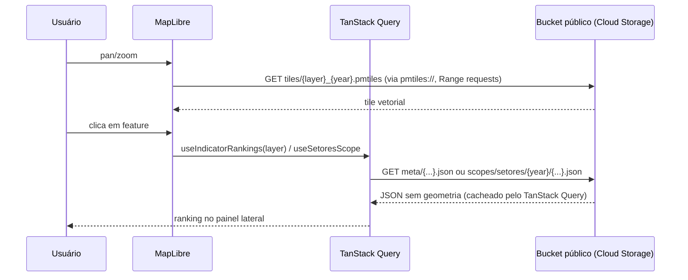

# Frontend — Mapa da Segregação

React 19 + TypeScript + Vite. Deploy estático via Firebase Hosting.

**Produção:** https://mapa-da-segregacao.web.app

## Stack

- React 19, TypeScript, Vite
- Bun (package manager — não use npm/yarn)
- MapLibre GL via `@vis.gl/react-maplibre` (tiles vetoriais)
- TanStack Query (cache de requisições)
- PMTiles (protocolo `pmtiles://` para MapLibre ler tiles direto do bucket) + `fetch` nativo para os artefatos JSON
- Tailwind CSS 4 + Radix UI / shadcn
- React Router v7

## Desenvolvimento

```bash
cd app
bun install
bun dev          # http://localhost:3000
bun run build    # dist/
bun run preview  # serve dist/ localmente
bun run lint
bun run test       # vitest run
bun run test:watch # vitest, modo watch
bun run format
```

## Variáveis de ambiente

```env
# app/.env.local
VITE_DATA_URL=http://localhost:3000/data   # padrão em dev, sem essa variável
```

`VITE_DATA_URL` é a URL base do bucket público do Cloud Storage que guarda os
tiles `.pmtiles` e os JSON estáticos (rankings, escalas, lookups) — ver
`.env.example`. Em desenvolvimento, sem a variável definida, o app assume que
`bun dev` está servindo o conteúdo de `pipeline/out` em `/data`. Em produção,
`app/.env.production` já traz a URL do bucket de produção
(`mapa-da-segregacao-dados`); o workflow de deploy também pode sobrescrevê-la
explicitamente antes do build, o que tem precedência sobre o arquivo.

Não existe mais `VITE_API_URL`, `VITE_API_KEY` nem chamada a uma API em
produção — isso foi removido na migração para tiles estáticos.

## Estrutura

```
src/
├── App.tsx              # Providers: TanStack Query, ThemeProvider, Router
├── Routes.tsx           # Rotas: / e /dashboard (lazy) + NotFound
├── pages/
│   ├── Home.tsx         # Landing page
│   └── Dashboard.tsx    # Mapa interativo
├── components/
│   ├── dashboard/       # DashboardMap, Sidebar, IndicatorRanking, PlaceDetails…
│   ├── layouts/         # MainLayout, DashboardLayout
│   └── ui/              # Radix UI / shadcn primitives
├── hooks/
│   ├── useSetores.ts    # TanStack Query sobre os artefatos estáticos: slugs, scope, escala
│   ├── useIndicatorRankings.ts  # Ranking client-side por camada
│   └── useLocationLookups.ts   # Cache de municípios (lista leve, JSON estático)
├── services/
│   ├── staticData/      # Cliente para os artefatos estáticos (config.ts, client.ts)
│   └── setores/         # Wrappers tipados, inclui as URLs pmtiles:// dos tiles
├── constants/
│   └── layers.ts        # Config das 3 camadas (setores/municípios/RMs)
└── lib/
    ├── mapFilters.ts    # resolveAllowedMunis — escopo do ranking
    └── format.ts        # formatNumber, formatPercent
```

## Fluxo do mapa



## Páginas

| Rota         | Componente      | Descrição                              |
| ------------ | --------------- | -------------------------------------- |
| `/`          | `Home.tsx`      | Landing page institucional             |
| `/dashboard` | `Dashboard.tsx` | Mapa + sidebar + toolbox (lazy loaded) |
| `*`          | `NotFound.tsx`  | 404                                    |

## Deploy

`app/.env.production` já traz `VITE_DATA_URL` apontando para o bucket de
produção; o CI pode sobrescrevê-la explicitamente antes do build, o que tem
precedência sobre o arquivo. Para deploy manual:

```bash
cd app
VITE_DATA_URL=https://storage.googleapis.com/mapa-da-segregacao-dados bun run build
firebase deploy --only hosting --project mapa-da-segregacao
```

O valor de `VITE_DATA_URL` para cada ambiente vem do output `data_base_url`
de `deploy/gcp/terraform-static/` — ver
`deploy/gcp/terraform-static/README.md`.
